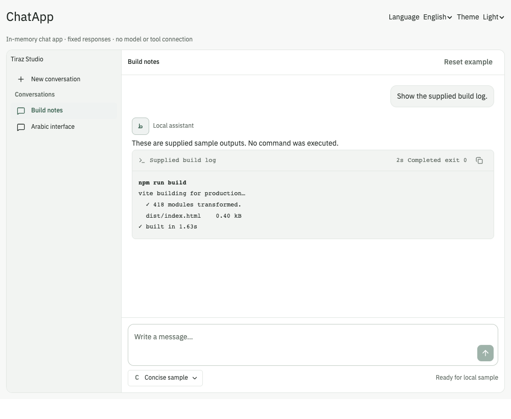
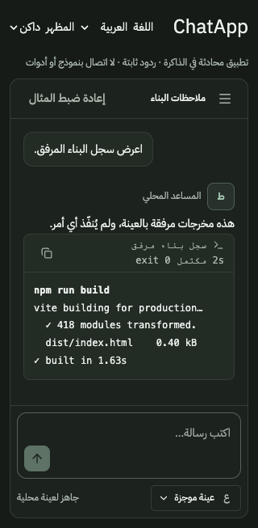

# Terminal and ChatApp

Implemented from baseline `751d11a420ec7c50fe5be6bea2c519f1debeb51a` on
`codex/terminal-and-chat-app` in the isolated checkout
`/Users/amjedfadul/.codex/worktrees/terminal-and-chat-app/Tiraz`.
Only local commits are authorized. Original checkout, its index/edits, landing
worktrees and unrelated servers are preserved.

## References

Both live references were available and inspected in the in-app browser:
[Terminal](https://formicai.dev/preview.html#/terminal) and
[ChatApp](https://formicai.dev/preview.html#/chatapp). Inspected command/output and
running/completed/failed presentation, copy and stop feedback, thread scrolling,
sending, model selection, new-chat behavior and narrow/wide layouts. The reference
new-chat action did not visibly reset its conversation. Its narrow gallery hides
the sidebar and clips horizontal content. Tiraz retains the quiet rail, small
header, flat assistant replies/user bubbles and composer hierarchy, using existing
Sheet navigation as requested for usable mobile access.

## Ownership and scope

Terminal receives command/output and status. Its copy string is exactly
`command + "\n" + output`, or output alone without a command. Whitespace and LTR
are preserved inside RTL; HTML and escape sequences stay literal text. No HTML or
ANSI interpreter, execution, emulator, process management, filesystem, WebSocket
or network is present. CodeBlock shares the guarded clipboard behavior. Internal
keyboard scrolling is bounded. Following is opt-in, near-bottom only, and pauses
for selection. Append-only text uses `Text.appendData` to preserve native substring
ranges; replacing removed selected content cannot retain that content.

ChatApp is a composition shell using Sidebar and Sheet with children, composer
and toolbar slots. The host owns conversations, stable identities, messages,
drafts, model and execution. Existing ChatThread, ChatComposer, PromptBar,
ModelSelector and StreamingText provide rendering and entry behavior. No backend,
authentication, persisted history, model connection or application framework.

The direct in-memory example has two sample conversations and a supplied build
log rendered with Terminal. Accepted send adds a user message and one stable
assistant; fixed response chunks update it. Stop retains received content.
Switching to a different conversation/new cancels the response and retains each
conversation's received content, draft and model. Selecting the current conversation
keeps its run. New conversations copy the selected model. Reset restores samples,
drafts and models; locale change resets to localized samples. Theme change retains
state. Unmount cancels timers. Captured conversation/message IDs and generation
guards prevent stale callbacks from crossing identities. Model choices are local
state; all responses are explicitly fixed samples.

## Running previews

- Documentation: [http://127.0.0.1:5337/](http://127.0.0.1:5337/) — Terminal and
  ChatApp are under **AI patterns** / **أنماط الذكاء الاصطناعي**.
- Direct example: [ChatApp, English](http://127.0.0.1:5337/examples/chat-app?lang=en)
  and [Arabic dark](http://127.0.0.1:5337/examples/chat-app?lang=ar&theme=dark).
- Regression fixture: [local fixture](http://127.0.0.1:5337/tests/browser/terminal-chat-app-fixture.html?lang=en).

Vite listens on loopback port 5337; no existing server was stopped or repurposed.

## Verification and evidence

Final result: **748 tests passed across 81 files**; **all nine browser check
groups passed**, zero captured page errors and zero axe violations. Build, lint,
formatting, source-copy and generated-example compilation passed.

Commands use Node 24.21.0 from the Mac's existing nvm installation. `npm ci`
installed the locked dependencies without a lockfile change. Build retains the
existing large-bundle warning.

- Focused Terminal, ChatApp, registry/source-copy and existing DatePicker tests:
  [regressions.txt](regressions.txt).
- Full suite: [suite.txt](suite.txt).
- TypeScript and production build: [build.txt](build.txt).
- Lint and formatting: [lint.txt](lint.txt), [format.txt](format.txt).
- Browser checks and engine/limitations: [results.json](browser/results.json).
- Accessibility violations: [axe.json](browser/axe.json).

Coverage includes exact unsafe-text copy and clipboard rejection, LTR/whitespace,
keyboard scrolling, old-output reading, live substring selection and following;
drafts/models, duplicate send guard, stable assistant node, stop/switch/new/reset
and unmount cancellation; Sheet focus trap, selection/new dismissal,
Escape/outside click and focus restoration; Arabic/English, light/dark,
1280×900/320×640/320×320, large type/standard density/plum/radius customization,
long multiline drafts and keyboard reachability of Send and Model. System and
emulated OS reduced-motion are tested independently on actual Sheet animation
styles. Continuous docs and shared demo-frame width are checked.

Registry tests compile Arabic/English generated snippets and all linked examples
after copying only `src/system` to a different application path. A Vite bundle of
the relocated ChatApp/Terminal examples and other sample assets verifies imports
without the workbench or repository README.

An independent reviewer identified React text replacement collapsing native
Terminal substring selections. A new regression failed before the fix, then
passed with the append-only text leaf. Chromium re-review confirmed both selected
text and scroll position survive appends. The reviewer also verified long-draft
Send/Model reachability at 320×320 after footer scrolling was bounded. A later narrow-header containment change briefly collapsed Terminal in centered
flex parents; explicit inline sizing and a browser regression corrected it. Final
source and Chromium re-review found no remaining actionable findings.

During concurrent development, Vite hot reload interrupted two browser runs;
they were rerun on settled source. One existing DatePicker test timed out under
concurrent three-worker load; its serial regression rerun passed. The final full
suite uses two workers and a 15-second test timeout. Earlier in-progress runs also
caught the selection regression and missing new-family test fixtures; those were
fixed before final verification.

No VoiceOver/screen-reader session, physical mobile device, Firefox or WebKit
verification was performed. IAB manual inspection and installed Chrome automation
provide Chromium evidence only. OS reduced-motion was emulated; no system setting
was changed. Automated accessibility checks do not establish screen-reader
conformance. These are in-memory demonstrations; no real AI or tool was executed.

## Captures

[Connected-flow recording](browser/connected-flow.webm): supplied Terminal output
→ send/stop → per-conversation drafts/switch → model choice → new/send/switch
cancellation → reset.

Additional captures include [mobile Sheet](browser/connected-mobile-sheet.png),
[Terminal documentation](browser/terminal-docs-ar.png),
[ChatApp documentation](browser/chat-app-docs-ar.png), and the
`ar|en-light|dark-1280x900|320x640|320x320.png` customization matrix in `browser/`.
